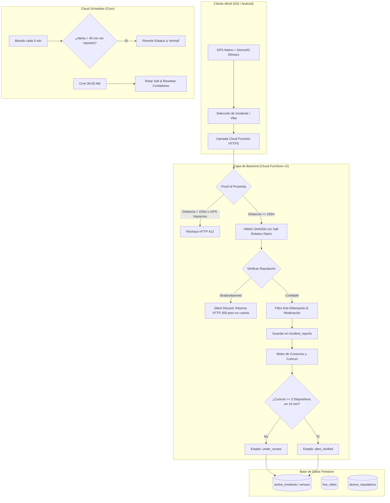

# Arquitectura Backend ColimaNight (Firebase + Cloud Functions)

Esta especificación detalla la infraestructura, diseño de base de datos, protocolos criptográficos de anonimato, motor de consenso en tiempo real y blindaje anti-difamación para la plataforma de vida nocturna de Colima (**ColimaNight**).

---

## 1. Diagrama de Arquitectura y Flujo de Datos

---

## 2. Esquema de Base de Datos en Firestore

### 2.1. Colección `venues`
Representa cada antro, bar o terraza registrada en la zona metropolitana de Colima y Villa de Álvarez.
- **Ruta:** `/venues/{venueId}`
- **Campos:**
  - `id`: `string` - ID único del bar.
  - `name`: `string` - Ej: *"El Guachi"*, *"Almada Cantina Fina"*, *"DMT Rock Bar"*.
  - `slug`: `string` - Identificador amigable en URL.
  - `category`: `string` - `'antro' | 'bar' | 'terraza' | 'cantina' | 'speakeasy' | 'club_playa' | 'sports_bar'`.
  - `location`: `GeoPoint` - Coordenadas precisas (latitud, longitud).
  - `address`: `string` - Dirección física.
  - `zone`: `string` - `'Corredor Ignacio Sandoval' | 'Centro Histórico' | 'Tercer Anillo' | 'Constitución / San Fernando' | 'Felipe Sevilla del Río' | 'Villa de Álvarez' | 'Zona Conurbada'`.
  - `proximityRadiusMeters`: `number` (opcional, 150m estándar por defecto; 280m para macro-recintos).
  - `currentOccupancyPercent`: `number` (0 a 100) - Estimación agregada en tiempo real.
  - `vibeScore`: `string` - `'tranquilo' | 'chill' | 'animado' | 'fiesta_total' | 'saturado'`.
  - `noiseLevelDbEstimated`: `number` (opcional) - Nivel sonoro representativo.
  - `celebrityPresence`: `map`
    - `hasCelebrity`: `boolean`
    - `description`: `string` (ej. "DJ Invitado Nacional")
    - `verified`: `boolean`
    - `reportedAt`: `Timestamp`
  - `liveMusic`: `map`
    - `hasLiveMusic`: `boolean`
    - `bandOrDjName`: `string`
    - `genre`: `string` (ej. "Rock en español", "House", "Banda")
    - `startTime`: `Timestamp`
    - `endTime`: `Timestamp`
  - `parking`: `map`
    - `status`: `'available' | 'almost_full' | 'full' | 'valet_only' | 'no_parking'`
    - `spotsEstimated`: `number`
    - `hasValet`: `boolean`
    - `lastUpdated`: `Timestamp`
  - `activePromos`: `array` de objetos `{ id, title, description, validUntil, daysOfWeek }`
  - `socialLinks`: `map` con `{ instagram, facebook, tiktok, phone, menuUrl }`
  - `securityStatus`: `map`
    - `level`: `'normal' | 'under_review' | 'alert_verified'`
    - `activeIncidentId`: `string | null`
    - `incidentType`: `string | null`
    - `lastReportedAt`: `Timestamp | null`
    - `alertExpiresAt`: `Timestamp | null`
    - `alertConfirmedAt`: `Timestamp | null`
    - `warningMessage`: `string | null`
  - `stats`: `map`
    - `checkinsTonight`: `number`
    - `averageWaitMinutes`: `number`
    - `lastVibeUpdate`: `Timestamp`
  - `active`: `boolean` (true para los 22 locales comerciales vigentes, false para memoriales/Easter Eggs)
  - `isActive`: `boolean` (alias de compatibilidad)
  - `isEasterEgg`: `boolean` (opcional, true para memoriales históricos como Barezzito en Av. Constitución 1450, lat: 19.2524, lng: -103.7210)
  - `createdAt`, `updatedAt`: `Timestamp`

### 2.2. Colección `live_vibes`
Check-ins temporales y señales de afluencia/fila en vivo enviados por usuarios in situ.
- **Ruta:** `/live_vibes/{vibeId}`
- **Campos:**
  - `venueId`: `string`
  - `hashedDeviceId`: `string` (HMAC rotativo)
  - `vibe`: `'tranquilo' | 'chill' | 'animado' | 'fiesta_total' | 'saturado'`
  - `crowdLevel`: `'vacio' | 'medio' | 'lleno' | 'sobrecupo'`
  - `waitMinutes`: `number` (tiempo en minutos de fila en puerta)
  - `location`: `GeoPoint`
  - `distanceMeters`: `number`
  - `createdAt`: `Timestamp`
  - `expiresAt`: `Timestamp` (TTL 120 minutos)

### 2.3. Colección `incident_reports`
Registro atómico de cada reporte de seguridad individual para auditoría interna y cálculo de cuórum.
- **Ruta:** `/incident_reports/{reportId}`
- **Campos:**
  - `venueId`: `string`
  - `incidentType`: `'pelea' | 'sobrecupo_critico' | 'altercado_violento' | 'operativo_policial' | 'acoso_inseguridad' | 'conato_bronca'`
  - `hashedDeviceId`: `string` (HMAC rotativo diario)
  - `saltDate`: `string` (`YYYY-MM-DD` de la noche operativa)
  - `clientLocation`: `GeoPoint`
  - `distanceMeters`: `number`
  - `rawComment`: `string` (opcional, máx 120 caracteres)
  - `sanitizedComment`: `string` (texto saneado sin nombres ni calumnias)
  - `moderationResult`: `map` con puntuación de toxicidad y palabras censuradas
  - `status`: `'submitted' | 'counted_in_quorum' | 'shadowbanned' | 'rejected_distance' | 'expired'`
  - `createdAt`: `Timestamp`
  - `expiresAt`: `Timestamp` (TTL 45 minutos)

### 2.4. Colección `active_incidents`
Consolidado del incidente en curso por establecimiento.
- **Ruta:** `/active_incidents/{venueId}`
- **Campos:**
  - `id`: `string` (coincide con `venueId` para acceso $O(1)$)
  - `venueId`: `string`
  - `incidentType`: `string`
  - `status`: `'under_review' | 'active_alert' | 'resolved' | 'expired' | 'debunked_by_staff'`
  - `reportCount`: `number`
  - `distinctDeviceCount`: `number`
  - `reportingDeviceHashes`: `array<string>`
  - `reportingCoordinates`: `array<{ latitude, longitude }>`
  - `firstReportAt`: `Timestamp`
  - `lastReportAt`: `Timestamp`
  - `alertTriggeredAt`: `Timestamp` (cuando alcanzó cuórum)
  - `expiresAt`: `Timestamp` (ventana rodante de 45 min)
  - `confirmedByStaff`: `boolean`
  - `staffUserId`: `string | null`
  - `warningMessage`: `string`

### 2.5. Colección `device_reputations` (Colección Interna / Shadowban)
Control persistente de credibilidad del dispositivo sin almacenar PII ni datos de hardware en crudo.
- **Ruta:** `/device_reputations/{reputationHash}`
- **Campos:**
  - `id`: `string` (HMAC con Pepper de larga duración)
  - `reputationScore`: `number` (0.0 a 1.0, por defecto 0.7)
  - `totalReportsSubmitted`: `number`
  - `reportsVerified`: `number`
  - `reportsDebunked`: `number`
  - `isShadowbanned`: `boolean`
  - `shadowbannedUntil`: `Timestamp | null`
  - `strikes`: `number`
  - `lastReportAt`: `Timestamp`
  - `updatedAt`: `Timestamp`

---

## 3. Protocolos de Seguridad y Blindaje

### 3.1. Anonimato Criptográfico con Corte Nocturno a las 06:00 AM
Para conciliar el anonimato del usuario con la prevención de ataques Sybil:
1. **Dilema de Medianoche Resuelto:** Los bares en Colima operan hasta las 03:00 - 05:00 AM. Si el salt rotara a las 00:00 (medianoche), un usuario podría duplicar reportes cambiando de hash a mitad de fiesta. Se implementó una **noche operativa con corte a las 06:00 AM**. Todos los reportes entre las 18:00 y las 05:59 del día siguiente comparten el mismo `saltDate`.
2. **Derivación HMAC:**
   $$\text{HashedDevice} = \text{HMAC-SHA256}(\text{DeviceFingerprint}, \text{MasterSecret} \mathbin{\Vert} \text{"\_DAILY\_"} \mathbin{\Vert} \text{SaltDate})$$
3. **Imposibilidad de Rastreo Histórico:** Al día siguiente, el salt cambia irreversiblemente. Es computacionalmente inviable reconstruir la trayectoria nocturna del usuario entre distintos fines de semana.

### 3.2. Proof of Proximity (Geocerca Estricta)
- **Fórmula de Haversine:** Calcula la distancia sobre la esfera terrestre entre la coordenada GPS del cliente y la del bar.
- **Restricción:** El reporte es inmediatamente rechazado si:
  - $\text{Distancia} > 150\text{ m}$.
  - $\text{Precisión GPS (Horizontal Accuracy)} > 40\text{ m}$ (mitiga spoofing por mock locations o rebotes de señal en interiores).

### 3.3. Algoritmo de Consenso y Cuórum Mínimo
- **Principio Anti-Pánico:** Un único reporte **NUNCA** tiñe el mapa de rojo ni declara una pelea pública.
- **Estado 1 (`under_review`):** Con 1 o 2 reportes, el incidente se registra como preventivo. No genera notificaciones masivas de peligro.
- **Estado 2 (`active_alert`):** Se requieren al menos **3 reportes independientes** que cumplan:
  1. Hashes de dispositivo estrictamente distintos (`distinctDeviceCount >= 3`).
  2. Ventana de tiempo rodante de **10 minutos**.
  3. Dispersión espacial mínima de al menos **5 metros** entre reportes para evitar que un mismo atacante con herramientas de script emule múltiples dispositivos desde el mismo píxel GPS.
- **Fast-Track de Personal Verificado:** Si el usuario autenticado tiene el rol `venue_staff` o `admin`, su confirmación manual activa o desactiva la alerta de inmediato sin requerir cuórum.

### 3.4. Blindaje Anti-Difamación y Moderación Textual
Para blindar a ColimaNight contra contingencias legales y demandas por daño moral o calumnia:
1. **Entrada Estructurada Obligatoria:** Los usuarios eligen categorías objetivas de incidentes (`pelea`, `sobrecupo_critico`, `operativo_policial`).
2. **Límite de Texto Libre:** Máximo 120 caracteres.
3. **Detección Heurística de Nombres Propios:** Algoritmo que detecta patrones del tipo:
   - `[Rol de Empleado] + [Nombre]` (ej. *"el cadenero Juan"*, *"el mesero Carlos"*, *"el dueño Pedro"*).
   - Acusaciones delictivas no comprobables (*"ratero"*, *"narco"*, *"clonador"*, *"droga"*).
4. **Censura y Redacción Automática:** Si se detecta un señalamiento personal o acusación individual, el texto del comentario se reemplaza automáticamente por:
   `"[Detalle omitido por normas de moderación y prevención de difamación]"`.
   El incidente objetivo sigue su conteo en cuórum de seguridad, pero ningún nombre de persona ni calumnia es publicado en la app.

### 3.5. Caducidad Automática (TTL de 45 minutos)
- Una alerta de pelea tiene relevancia efímera.
- Cada documento de `active_incidents` define `expiresAt = now + 45 min`.
- Si ingresa un nuevo reporte legítimo durante la alerta, el `expiresAt` se prorroga 45 minutos adicionales desde el último reporte.
- La función programada `cleanupExpiredIncidents` corre cada 5 minutos mediante Cloud Scheduler, detecta alertas vencidas y restaura el semáforo del local a `'normal'`.

### 3.6. Reputación de Dispositivo y Shadowban Silencioso
- Se computa un seudónimo permanente $\text{HMAC}(\text{Fingerprint}, \text{Pepper})$.
- Si un usuario genera reportes falsos que el staff desmiente, acumula *strikes* y su reputación decrece en 0.3.
- Si su puntaje cae por debajo de 0.35 o acumula 2 strikes, entra en **Shadowban por 72 horas**.
- **Mecanismo de Trampa Silenciosa:** Cuando un dispositivo en shadowban intenta reportar, la API responde `HTTP 200 OK` con mensaje exitoso ficticio. El reporte se marca internamente como `shadowbanned` y **no se suma al cuórum**. El atacante no tiene retroalimentación de que fue neutralizado.

---

## 4. Matriz de Seguridad en Firestore Rules

| Colección | Lectura Pública | Escritura Cliente | Control de Modificación |
|---|---|---|---|
| `/venues` | Sí (Todos) | No (Bloqueada) | Staff solo puede editar fotos/promos. Estado de seguridad reservado para Cloud Functions con Admin SDK. |
| `/live_vibes` | Solo Admin | No (Bloqueada) | Escritura exclusiva por `submitVibe` tras validar 150m de geocerca. |
| `/incident_reports` | Solo Admin | No (Bloqueada) | Escritura exclusiva por `reportIncident`. Contiene coordenadas y hashes. |
| `/active_incidents` | Sí (Solo `active_alert`) | No (Bloqueada) | Reportes `under_review` invisibles al público común para evitar pánico. |
| `/device_reputations`| No (Bloqueada) | No (Bloqueada) | Acceso restringido 100% a Firebase Admin SDK. |

---

## 5. Endpoints de Cloud Functions Implementados

1. **`reportIncident` (HTTPS onCall):** Ingesta de reportes con geocerca Haversine, hash HMAC diario, saneamiento de difamación, verificación de reputación/shadowban y disparo de cuórum.
2. **`submitVibe` (HTTPS onCall):** Ingesta de señales de ambiente y afluencia con cálculo agregado en tiempo real de ocupación y tiempo de espera.
3. **`verifyIncidentByStaff` (HTTPS onCall):** Acción administrativa de gerentes o cadeneros autorizados mediante Custom Claims (`venue_staff`) para confirmar o desmentir incidentes.
4. **`cleanupExpiredIncidents` (Cron cada 5 minutos):** Desactivación automática de alertas obsoletas tras 45 minutos.
5. **`resetNightlyCounters` (Cron diario 06:00 AM):** Reseteo diario de contadores de asistencia nocturna.
